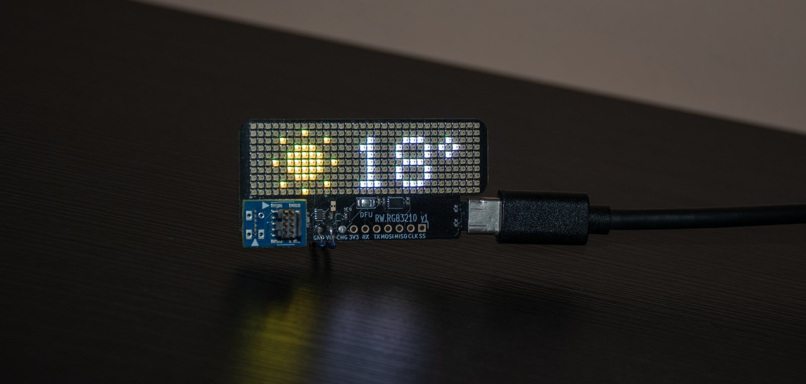
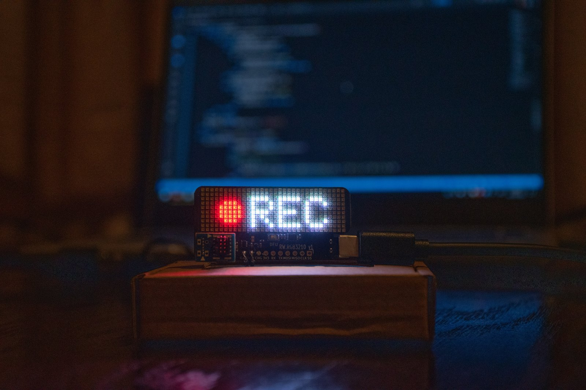
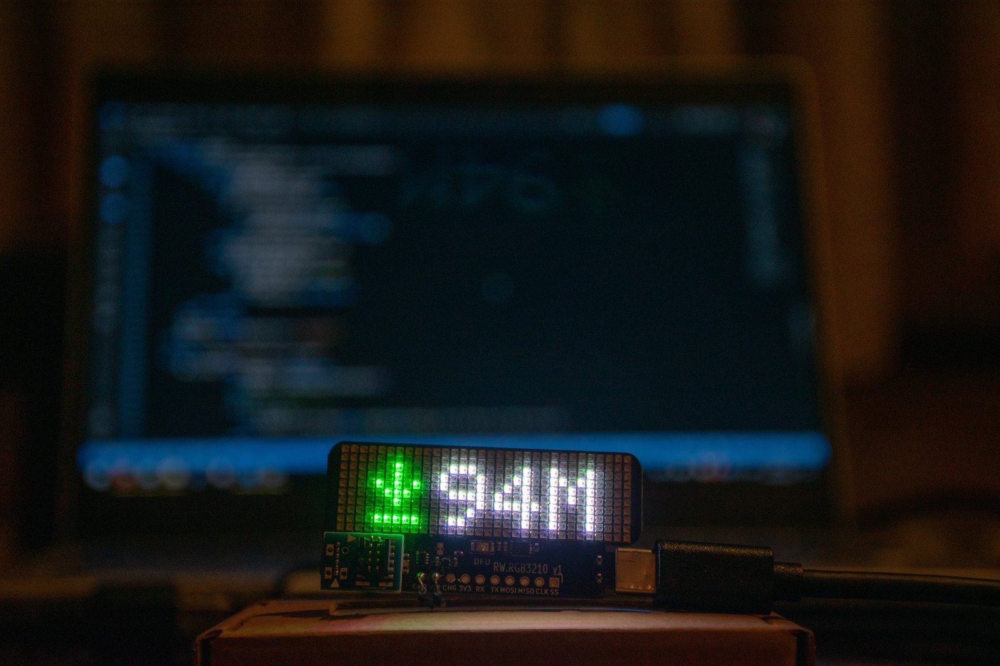
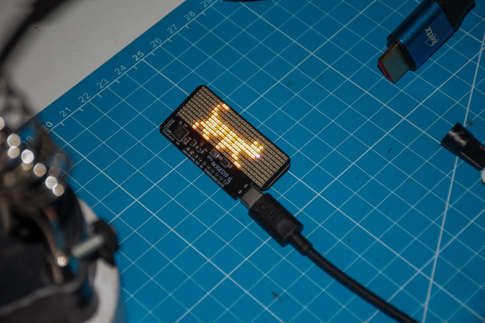

# RW.RgbDisplay



A very bright RGB display built from discrete addressable LEDs. The first revision is
`rgb3210`: a 32×10 matrix of 320 LEDs on a board of about 55×26.5 mm.

The original goal was an image source for **projection**: with an external lens, a matrix like
this projects coloured text and animation onto a wall in the dark. No off-the-shelf module is
suitable for that. Ordinary LED matrices and panels are made to be looked at, so they have a
coarse pitch, diffusers and just enough brightness for indoor indication. Hence this design: a
fine pitch (≈1.6 mm, active area ≈49×14 mm), no diffusers and brightness to spare.

The experiment worked, and it became clear that a board like this has more uses than the
original one: a desk status sign, a wearable badge, a bright display for development boards.

| | |
| --- | --- |
|  |  |
|  |  |

The photos show the rgb3210 v1 board displaying uploaded bitmap images; the small board on the
left is an SWD adapter.

## Key ideas

- **Discrete addressable LEDs instead of a ready-made panel.** A dense matrix of 1×1 mm LEDs
  at a ≈1.6 mm pitch on a custom board. This is what makes projection possible: the pitch and
  diffusers of ready-made panels produce a blurry spot on the wall.
- **Standalone operation is the main mode.** The image and the playback program are stored in
  the microcontroller's flash, and the module plays them on its own after power-up. A computer
  is needed only to upload them.
- **No host-side drivers.** The device enumerates as a virtual COM port and is controlled by a
  simple byte protocol, from any language and any OS.
- **One protocol for the whole family.** The command protocol and client libraries are designed
  as an interface to any matrix of the family, not to this particular 32×10.
- **Any host.** USB is only the first interface; the target use cases include development
  boards, which need UART, I²C and SPI.
- **Open software.** The firmware, protocol and library are Apache-2.0 and the schematic is
  published, so you can understand the device and write your own software for it.

## What is in this repository

| Path | Contents | Licence |
| --- | --- | --- |
| [`fw/rgb3210/`](fw/rgb3210/) | STM32G431 firmware (STM32CubeMX + CMake) | Apache-2.0 (plus vendor code from ST/Arm) |
| [`app/`](app/) | protocol library, control application and status graphs for Linux and Windows | Apache-2.0 |
| [`docs/rgb3210v1-schematic.pdf`](docs/rgb3210v1-schematic.pdf) | schematic of the v1 board | for reference only |

The board design sources (KiCad project, layout, fabrication data) are not part of this
repository.

## Hardware

| | |
| --- | --- |
| Matrix | 32×10, XL-1010RGBC-2812B LEDs (WS2812B-compatible, 1×1 mm package) |
| MCU | STM32G431K6U6 (Cortex-M4, 32 KB flash), 32 MHz crystal, 168 MHz SYSCLK |
| Host interface | USB-C (USB 2.0 FS), CDC class — virtual COM port |
| Power | USB-C or battery |
| Converter | TPS631000 buck-boost |
| Power switching | TPS2116 / TPS2117 power mux |
| Charger | MCP73831 |
| Logic supply | TPS7A2033 LDO (3.3 V) |
| Controls | one on-board button (labelled `DFU`) |
| Connectors | USB-C, SWD, 10-pin header: `GND VIN CHG 3V3 RX TX MOSI MISO CLK SS` |
| PCB | 4 layers |

The full schematic is in [docs/rgb3210v1-schematic.pdf](docs/rgb3210v1-schematic.pdf)
(22 sheets: root sheet with the MCU, USB and charging, power, matrix rows).

### Matrix

The LEDs form 10 independent chains — one per display row, 32 LEDs each (in the schematic a row
consists of two sheets of 16 LEDs, DIN→DOUT). Each chain is driven by its own MCU pin, and all
ten rows are clocked out **simultaneously**:

| Row | MCU pin | Row | MCU pin |
| --- | --- | --- | --- |
| 0 | PA0 | 5 | PA15 |
| 1 | PA1 | 6 | PB0 |
| 2 | PA2 | 7 | PB3 |
| 3 | PA3 | 8 | PB5 |
| 4 | PA8 | 9 | PB7 |

Other pins: button — PB8 (`BTN`); PA4 (`SS`) is read as a second button input; USART1 —
PA9/PA10 (115200 baud); SPI1 slave — PA5…PA7. UART and SPI are routed and initialised but not
yet used by the firmware.

### Status of v1

The rgb3210 v1 revision has been built and works: the matrix lights up, USB works, the program
is saved to flash and plays back standalone. It is a prototype and not ready for series
production; the next board revision is in progress.

> **Be careful with brightness.** 320 LEDs at full brightness mean noticeable heating of a
> finger-sized board and light that is unpleasant to look at. Start with `Bright 3…20`. The
> firmware limits brightness when the board gets hot (see [Thermal protection](#thermal-protection)),
> but that is a safety net, not a reason to run the board at full power.

## Firmware

Directory [`fw/rgb3210/`](fw/rgb3210/). The project is generated by STM32CubeMX
(`rgb3210.ioc`) and built with CMake + `arm-none-eabi-gcc`. All custom code lives in
`Core/Src/main.c` and `USB_Device/App/usbd_cdc_if.c`, inside the `USER CODE` blocks.

What it does:

- receives a byte stream over USB CDC: pixel data and a "program" made of steps;
- runs the program: fill, show frame, scroll, delays, wait for button;
- saves the program and the image to flash and plays them back standalone after power-up,
  without a host;
- watches the MCU temperature and dims or blanks the display when the board overheats;
- reports the temperature and the current brightness limit to the host on request.

### Building and flashing

```sh
cd fw/rgb3210
cmake --preset Release        # presets: Release | MinSizeRel | RelWithDebInfo
cmake --build --preset Release
```

The result is `build/<preset>/rgb3210.elf`. Flash it with any SWD programmer, for example an
ST-Link via OpenOCD:

```sh
openocd -f interface/stlink.cfg -f target/stm32g4x.cfg -c "program build/Release/rgb3210.elf verify reset exit"
```

Without a programmer the firmware can be loaded over USB through the MCU's built-in DFU
bootloader: enter it with the on-board `DFU` button, then use STM32CubeProgrammer and reconnect
the board afterwards:

```sh
STM32_Programmer_CLI -c port=USB1 -w build/Release/rgb3210.elf -v
```

Either way only the firmware pages are written, so a program and image saved in flash survive
the update.

The repository also contains a VisualGDB project (`fw/RGB3210.sln`, `RGB3210.vgdbcmake`); it is
optional.

### How the output works

The LEDs are driven by software bit-banging of the ten chains in parallel (`DisplayUpdate()`),
without DMA or interrupts: timing comes from polling the TIM17 counter (84 MHz, ≈11.9 ns per
tick). The edges of all ten rows are produced by a single register write per GPIO port, so every
row gets identical pulses; the bit timing follows the LED datasheet (0 bit ≈0.36 µs high, 1 bit
≈0.95 µs high, ≈1.3 µs period, ≈300 µs reset). Interrupts are disabled while a frame is being
sent, so USB is silent during that time — the host has to send data in small chunks (see below).

### Thermal protection

The firmware reads the MCU's internal temperature sensor once a second (ADC1 with factory
calibration, filtered) and scales the output accordingly:

| Die temperature | Output |
| --- | --- |
| up to 55 °C | full brightness |
| 55 … 75 °C | reduced linearly down to 10 % |
| 80 °C and above | display off until it cools below 75 °C |

The limit is applied to everything the display shows — frames, fills and scrolls — on top of
`Bright`, and it also works while a program is stopped or waiting. The die follows the board
temperature with a lag, which is why the thresholds sit well below the LEDs' 85 °C rating.

### Memory

The program and the pixel data form a single 7232-byte block, kept in RAM and written to flash
on command:

```
0     … 511    program: 128 steps × 4 bytes (opcode, arg0, arg1, arg2)
512   … 7231   pixels: 10 rows × 672 bytes
```

Each row is 672 bytes = 224 pixels × 3 bytes. In other words, memory holds a virtual
**224×10** canvas (7 "frames" of 32 pixels side by side), and the display shows a 32-pixel-wide
window of it. Frame-by-frame output and scrolling are built on this.

The colour component order in the buffer and in the protocol is **G, R, B**.

MCU flash layout: the first 24 KB hold the firmware, the last 8 KB (from `0x08006000`) hold
user data. The firmware must fit into 24 KB.

## Protocol

The device appears as a virtual COM port. The host sends a byte stream; byte `170` (`0xAA`) is
the prefix of a control sequence:

| Sequence | Action |
| --- | --- |
| `170, 0` | write a literal byte 170 to the buffer (escape) |
| `170, 16` | write pointer → 0 (start of the program area) |
| `170, 17+y`, y = 0…9 | write pointer → start of pixel row y |
| `170, 64` | start the program from step 0 |
| `170, 65` | stop the program |
| `170, 66` | interrupt the current wait (`Wait` / `Sec`) |
| `170, 128` | clear the display |
| `170, 129` | erase flash and write the current buffer to it |
| `170, 130` | reply with a text line `temp=<°C> limit=<percent>\n`: filtered MCU temperature and the thermal brightness limit |

Any other byte is written to the buffer at the write pointer, and the pointer advances by 1
(writes past the end of the buffer are ignored).

A typical upload: `170, 65` (stop) → `170, 16` + program steps (up to 128 steps of 4 bytes) →
for each row `170, 17+y` + up to 672 bytes of pixels (G, R, B; bytes equal to 170 are escaped
as `170, 0`) → `170, 64` (start) and, to make it persistent, `170, 129`. The reference
implementation is [`DisplayProtocol.vb`](app/RW.LedDisplay/DisplayProtocol.vb).

Send data in chunks of at most 64 bytes with a pause of about 10 ms between them — otherwise
the firmware cannot keep up while it refreshes the display.

### Program steps

A step is 4 bytes: an opcode and three arguments. In the application a program is written as
text, one step per line — `Command arg0 arg1 arg2` (arguments are numbers 0…255, missing ones
default to 0).

| Command | Opcode | Arguments | Action |
| --- | --- | --- | --- |
| `Nop` | 0 | — | nothing (255 — erased flash — is treated the same) |
| `Bright` | 1 | `percent` | brightness 0…100 % for subsequent image output. Brightness is 1 % after power-up |
| `Clear` | 8 | — | turn the display off |
| `Fill` | 9 | `r g b` | fill with a colour (`Bright` is not applied) |
| `Frame` | 16 | `n` | show frame n (0…6) |
| `FromX` | 17 | `x` | show the window starting at canvas column x |
| `Wait` | 64 | — | wait for a button press (or `170, 66` from the host) |
| `Msec` | 65 | `ms` | delay 0…255 ms |
| `Sec` | 66 | `s` | delay 0…255 s, can be interrupted by `170, 66` |
| `ScrollLeft` | 128 | `from to delay` | scroll one column at a time from frame `from` to frame `to`, `delay` ms between steps |
| `ScrollRight` | 129 | `to from delay` | the same in reverse: from frame `arg1` back to frame `arg0` |
| `Restart` | 254 | — | jump to step 0 |

After the last (128th) step the program stops. Example:

```
Bright 15
Frame 0
Sec 2
ScrollLeft 0 6 30
Wait
ScrollRight 0 6 30
Restart
```

The opcodes are implemented in three places that must be kept in sync: `DisplayCommandType`
(`app/RW.LedDisplay/DisplayCommand.vb`), `ProcessProgram()` in the firmware and the
`DisplayEmulator` software emulator (`app/RW.LedDisplay/DisplayEmulator.vb`).

## Applications

Everything in [`app/`](app/) is VB.NET. Each application has its own solution,
`app/<name>.sln`, holding the application and the library.

- [`app/RW.LedDisplay/`](app/RW.LedDisplay/) — library (.NET Standard 2.0): protocol
  (`DisplayProtocol`), commands (`DisplayCommand`), sending to the port (`DisplaySender`),
  port lookup (`DisplayPorts`) and the software emulator (`DisplayEmulator`).
- [`app/RW.LedDisplay.ControlApp/`](app/RW.LedDisplay.ControlApp/) — control application for
  **Linux and Windows** (Avalonia, .NET 10): image loading, program editor, software display
  emulator, upload to the device and to flash.
- [`app/RW.LedDisplay.ControlApp.Win/`](app/RW.LedDisplay.ControlApp.Win/) — the earlier
  Windows-only version of the same application (WinForms, .NET 10).
- [`app/RW.LedDisplay.CpuGraph/`](app/RW.LedDisplay.CpuGraph/),
  [`MemGraph`](app/RW.LedDisplay.MemGraph/), [`BtcGraph`](app/RW.LedDisplay.BtcGraph/) —
  console utilities for Linux and Windows that keep a live graph on the display while they run.
- [`app/linux/`](app/linux/) — autostart of the graphs on Linux.

### Control application

```sh
dotnet run --project app/RW.LedDisplay.ControlApp
dotnet build app/RW.LedDisplay.ControlApp.sln
```

On Linux it needs the usual X11 libraries, on Debian/Ubuntu
`sudo apt install libice6 libsm6 libx11-6 libfontconfig1`, and write access to the serial port
(the udev rule from `app/linux/` grants it; otherwise add yourself to the `dialout` group).

Image to upload: exactly 10 pixels high, 32 to 224 pixels wide (7 frames). An example is
`app/RW.LedDisplay.ControlApp.Win/test.bmp`, loaded at start. In the emulator, clicking the
display simulates a button press for the `Wait` command.

The WinForms version builds on Windows only:

```sh
dotnet run --project app/RW.LedDisplay.ControlApp.Win
dotnet publish app/RW.LedDisplay.ControlApp.Win -p:PublishProfile=FolderProfile   # single-file win-x64
```

### Graphs

| Utility | Shows |
| --- | --- |
| `CpuGraph` | load of every CPU core, one bar per core, dark green when idle to bright red at full load |
| `MemGraph` | history of used memory, one column per sample, same colours |
| `BtcGraph` | the last 32 BTC/USDT candles from the public Binance API (no key needed), green for a candle that closed up, red for down |

```sh
dotnet run --project app/RW.LedDisplay.CpuGraph                          # default port, 1 s, 10 % brightness
dotnet run --project app/RW.LedDisplay.MemGraph -- /dev/ttyACM0 1 40     # port, interval in seconds, brightness %
dotnet run --project app/RW.LedDisplay.CpuGraph -- --flip --left         # panel mounted upside down, mirrored
dotnet run --project app/RW.LedDisplay.BtcGraph -- COM4 15m 10           # port, candle interval, brightness %
```

Without a port argument the utilities use `/dev/ttyACM0` on Linux and, on Windows, the COM
port of the first connected display. The display is found by its USB ID `0483:5740`, which is
ST's generic virtual COM port ID — with another ST board attached, name the port explicitly.
Ctrl+C stops the program on the display and clears it.

### Autostart on Linux

`app/linux/install.sh` publishes the graphs to `~/.local/lib/rgb3210` and installs a udev rule
and a systemd user service. Every connected display then gets a stable name,
`/dev/rgb3210/<serial>`, and its own service instance that starts on plug-in and stops on
removal. What each display shows is set in `~/.config/rgb3210/<serial>.conf` (see
`app/linux/rgb3210.conf.example`); the default is `CpuGraph`.

## Licences

The repository is licensed in parts — see [LICENSE](LICENSE) for the full statement:

| Part | Licence |
| --- | --- |
| Software: `app/`, firmware (code by Rainwalker OÜ) | Apache License 2.0 |
| ST/Arm vendor code under `fw/rgb3210/Drivers/`, `Middlewares/` | their own terms: Apache-2.0 (CMSIS), BSD-3-Clause (HAL), SLA0044 (USB Device Library — STMicroelectronics MCUs only) |
| Schematic `docs/rgb3210v1-schematic.pdf` | published for reference, all rights reserved |

The board design (schematic, layout, fabrication data) is the property of Rainwalker OÜ.

© 2026 Rainwalker OÜ
